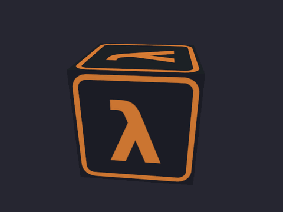

# guile-vulkan

[](https://github.com/ebenali/guile-vulkan/actions/workflows/ci.yml)



Vulkan 1.4 bindings for [GNU Guile](https://www.gnu.org/software/guile/),
generated from the Vulkan headers. They need nothing beyond Guile 3 and a
Vulkan loader: no C compiler and no third-party Guile libraries.

Names, layouts and generation rules follow
[chez-vulkan](https://github.com/ebenali/chez-vulkan), so code ports between
the two easily.

## Documentation

The manual, `doc/guile-vulkan.texi`, covers installation, the struct and
pointer API, functions, the window systems and `(vulkan compute)` in full.
The Guix package installs it (`info guile-vulkan`); from a checkout, build
it with `makeinfo doc/guile-vulkan.texi` and read it with
`info -f ./guile-vulkan.info`, or build HTML with
`makeinfo --html --no-split doc/guile-vulkan.texi`.

## Modules

- `(vulkan)`: every Vulkan 1.4 type, constant and function, plus the struct
  and pointer helpers below.
- `(vulkan constants)`: the `#define` constants CastXML can't see
  (`vk:api-version-1-3`, `vk:whole-size`, `vk:make-api-version`, …).
- `(vulkan xlib)`, `(vulkan xcb)`, `(vulkan wayland)`, `(vulkan win32)`: the
  window-system surfaces.
- `(vulkan compute)`: GPU tensors for numerical work, built on the above
  (see below).

The library loads the Vulkan loader under its platform's name:
`libvulkan.so.1` on Linux, `vulkan-1.dll` on Windows, `libvulkan.1.dylib`
(falling back to MoltenVK) on macOS.

## Structs

Structs are bytevectors. Each struct name is a macro that knows its layout,
so field access compiles to a direct bytevector access at a constant offset:

```scheme
(use-modules (vulkan) (vulkan constants))

(define info
  (vk-new vk:instance-create-info
          (s-type vk:structure-type-instance-create-info)
          (p-application-info
           (vk-new vk:application-info
                   (s-type vk:structure-type-application-info)
                   (p-application-name "my app")
                   (api-version vk:api-version-1-3)))))

(vk-ref vk:physical-device-properties (limits max-image-dimension2-d) props)
(vk-ref vk:physical-device-memory-properties (memory-types i property-flags) props)
(vk-set! vk:queue-family-properties (queue-count) families 2 1)  ; element 2
```

- `(make-vk T)` / `(make-vk T n)`: a zeroed T, or n of them.
- `(vk-new T (field ... value) ...)`: a zeroed T with the given fields set.
- `(vk-ref T (path ...) bv [index])` / `(vk-set! T (path ...) bv [index] value)`:
  a path names fields; an array field is followed by an index.
- `(vk-sizeof T)`, `(vk-offset T (path ...))`.
- `(vk-c-string-ref bv offset)` reads a NUL-terminated string, for example
  a device name.

## Pointers and lifetimes

Wherever Vulkan takes a pointer, you can pass a bytevector, and it is kept
alive for you:

- a **pointer field** set with `vk-set!` or `vk-new` accepts a bytevector, a
  string (stored as a NUL-terminated UTF-8 copy) or `#f`. The object stays
  alive as long as the struct holding it, until the field is set again. That
  makes nested `vk-new` forms like the one above safe;
- a **pointer or handle argument** of a Vulkan function accepts a bytevector
  or `#f`, and the bytevector stays alive during the call.

Pointers and handles are otherwise integers. An address you compute yourself
(for example with `vk-address`) is not tracked, so keep that object
reachable while Vulkan may use it. `vk-bytevector` views foreign memory, for
example mapped device memory, as a bytevector.

## Functions

Functions every Vulkan loader exports (core 1.0–1.4 and the window-system
functions) are bound directly, for example `vk:create-instance`. Every
function, including those, also has a `vk:load-*` procedure that fetches it
at runtime. It returns a procedure, or `#f` if the function is unavailable:

```scheme
(define draw-mesh-tasks (vk:load-cmd-draw-mesh-tasks-ext device))
(when draw-mesh-tasks
  (draw-mesh-tasks command-buffer x y z))
```

Device-level functions (first parameter a `VkDevice`, `VkQueue` or
`VkCommandBuffer`) take a device; the rest take an instance, or `#f` for
global functions.

## GPU tensors: `(vulkan compute)`

1-D and 2-D arrays of 32-bit floats in GPU memory, with the operations a
small neural network needs:

```scheme
(use-modules (vulkan compute))

(define x (list->tensor '(1 2 3 4 5 6) '(2 3)))
(define w (list->tensor '(1 0 0 1 1 1) '(3 2)))
(tensor->list (tensor-relu (tensor-matmul x w)))   ; => (4.0 5.0 10.0 11.0)
```

- Tensors: `make-tensor`, `list->tensor`, `f32vector->tensor`,
  `tensor->f32vector`, `tensor->list`, `tensor-reshape` (a view),
  `tensor-shape`.
- Matrix multiply: `(tensor-matmul a b #:transpose-a? #:transpose-b? #:alpha)`.
- Elementwise: `tensor-add`, `tensor-sub`, `tensor-mul`, `tensor-div` (the
  second operand may be a row added to every row, e.g. a bias),
  `tensor-relu-backward`, `tensor-relu`, `tensor-scale`, `tensor-add-scalar`,
  `tensor-exp`, `tensor-tanh`, `tensor-sigmoid`, `tensor-copy`.
- Reductions: `tensor-softmax-rows`, `tensor-sum-rows` (column sums).

Operations are queued on the GPU rather than run one by one. Reading a
result (`tensor->f32vector`, `tensor->list`) or calling `compute-flush!`
submits everything queued and waits. Tensors are freed by the garbage
collector, once the GPU is done with them, or with `tensor-free!`. Their
buffers are kept for new tensors of the same size (up to 256 MiB), so a
training loop doesn't allocate GPU memory every step.
Guile's collector doesn't see GPU memory, so the module forces a collection
to free unreferenced tensors in three cases: after every 256 MiB of tensors
allocated; when the number of live allocations nears the device's limit
(which can be as low as 4096, common on Windows); and when an allocation
fails for lack of memory or of allocations. `tensor-free!` releases memory
sooner, which is useful for large tensors.

A context (device and queue) is created on first use, on the most capable
device: a discrete GPU first, then integrated, then a software renderer.
`(make-compute-context #:device n)` together with `current-compute-context`
choose another. Since f32vectors are bytevectors, data moves to and from
other array libraries (SRFI-4, newra, Guile-CV) without conversion.

A 2048×2048 matrix multiply reaches about 1–2 TFLOP/s on current mid-range
GPUs, and about 35 GFLOP/s on Mesa's software renderer. Plain Guile manages
about 0.3 GFLOP/s.

The shaders are in `shaders/*.comp`. `guile shaders/build.scm` compiles them
(it needs glslangValidator) and embeds the SPIR-V in
`vulkan/compute/shaders.scm`.

## Examples

Run from the repository root:

- [`examples/compute`](examples/compute): `guile -L .
  examples/compute/compute.scm [device-index]` squares 1000 floats with a
  compute shader and checks the result.
- [`examples/gears`](examples/gears): `guile -L .
  examples/gears/gears.scm [--device N] [--novsync]` draws the classic three
  spinning gears in an X11 window (XWayland on Wayland
  desktops), with Vulkan 1.3 dynamic rendering. Arrow keys and `z`/`Z`
  rotate the view, Esc quits. It needs only libX11; the Xlib bindings are in
  `examples/x11.scm`, which describes X's event structs with
  `define-vk-struct`.
- [`examples/cube`](examples/cube): `guile -L . examples/cube/cube.scm
  [--device N] [--novsync]` draws a spinning, lit, λ-textured cube in a
  native Wayland window. It needs only libwayland-client: `examples/wayland.scm`
  builds the xdg-shell interface tables in Scheme and receives events
  through `procedure->pointer` callbacks. It shows texture upload with
  mipmaps, a sampler and a descriptor set.
- [`examples/spirals`](examples/spirals): `guile -L .
  examples/spirals/spirals.scm [--device N]` trains a small neural network
  on the GPU with `(vulkan compute)` to tell three interleaved spirals
  apart, then draws what it learned.

Tests, also run from the repository root: `guile -L . tests/compute.scm
[device-index]` checks every `(vulkan compute)` operation against plain
Guile. `tests/xcb-surface.scm` (for example under `xvfb-run`) and
`tests/wayland-presentation.scm` check the window-system modules.
`guile tests/compare-with-chez-vulkan.scm path/to/chez-vulkan/vulkan.ss`
checks that the bindings match chez-vulkan's. CI runs all of them, and the
examples, on Mesa's software Vulkan driver (lavapipe) under Xvfb and a
headless Weston.

A Guix package for this checkout: `guix build -f guix.scm`.

The first run compiles `(vulkan)`, which takes about 20 seconds; Guile caches
the result.

## Regenerating

The modules are generated by `generate.scm` from a
[CastXML](https://github.com/CastXML/CastXML) parse of the Vulkan headers
(currently 1.4.363):

```sh
castxml --castxml-gccxml -DVK_USE_PLATFORM_XLIB_KHR \
  -DVK_USE_PLATFORM_XLIB_XRANDR_EXT -DVK_USE_PLATFORM_XCB_KHR \
  -DVK_USE_PLATFORM_WAYLAND_KHR -o res/vulkan.xml /usr/include/vulkan/vulkan.h
guile generate.scm
```

`vulkan/win32.scm` comes from a second parse for 64-bit Windows, which needs
the Windows SDK and MSVC headers (for example from
[msvc-wine](https://github.com/mstorsjo/msvc-wine)). The generator checks
that the core module from that parse is identical to `vulkan.scm`:

```sh
WINSDK_INCLUDE=... MSVC_INCLUDE=... res/make-win32-xml.sh
guile generate.scm res/vulkan-win32.xml
```

## License

LGPL-3.0-or-later. See `COPYING.LESSER` and `COPYING`.
