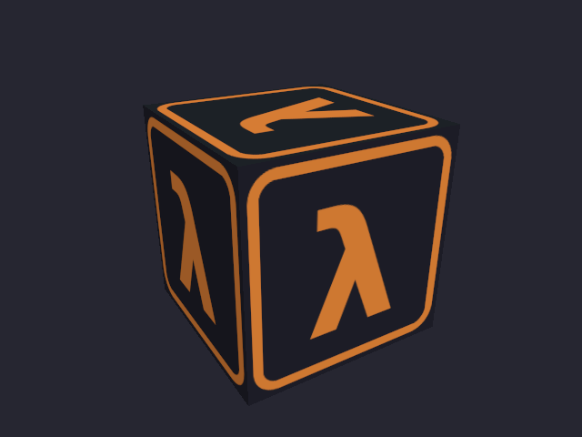

# Cube



A spinning, lit, textured cube in a native Wayland window, drawn with Vulkan
from Guile. It needs only Guile, a Vulkan 1.3 driver and libwayland-client:
no toolkit, no XWayland.

## Running

From the repository root, in a Wayland session:

```sh
guile -L . examples/cube/cube.scm [--device N] [--novsync] [--frames N] [--step DEGREES]
```

- `--device N`: use the Nth Vulkan device instead of the first suitable one.
- `--novsync`: present as fast as possible instead of in step with the
  display.
- `--frames N`: quit after N frames.
- `--step DEGREES`: turn the cube by a fixed angle per frame instead of by
  elapsed time, for reproducible captures.

Keys: the arrow keys rotate the cube while held, space pauses the spin, and
Esc quits. Closing the window also quits.

The window has no title bar. Wayland leaves decorations to the client
(xdg-shell), and some compositors, GNOME among them, don't draw them for it.

## What it shows

- **A Wayland client with only libwayland-client:** `examples/wayland.scm`.
  - The xdg-shell protocol's interface tables are normally generated by
    `wayland-scanner`. Here they're built in memory with `define-vk-struct`.
  - Requests go through the non-variadic `wl_proxy_marshal_array_flags`.
  - Events arrive in Guile procedures made callable from C with
    `procedure->pointer`.
  - Keys are raw evdev codes, so no libxkbcommon is needed.
- **Texture upload:**
  - The λ texture is a binary PPM, read in Scheme.
  - It goes through a staging buffer into an sRGB image.
  - The mipmaps are made on the GPU with `vk:cmd-blit-image`.
  - It's sampled with anisotropic filtering where the device has it.
- **A descriptor set** binding the texture and its sampler for the fragment
  shader.
- **An sRGB swapchain,** so the sRGB texture shows its true colors.
- **Resizing:** the swapchain follows the window's size, since on Wayland
  the swapchain decides the window size (the surface reports `#xFFFFFFFF`).
- **Shared with the gears example:** dynamic rendering, push constants for
  the matrices, two frames in flight, and the flipped viewport.

## Shaders and texture

`cube.vert` transforms the vertices and computes the lighting; `cube.frag`
samples the texture. To rebuild the `.spv` files:

```sh
glslangValidator -V examples/cube/cube.vert -o examples/cube/cube.vert.spv
glslangValidator -V examples/cube/cube.frag -o examples/cube/cube.frag.spv
```

`lambda.ppm` is a 256×256 binary PPM (`P6`, 8 bits per channel). Any image
converted to that format can replace it, for example with
`convert image.png -strip -depth 8 ppm:examples/cube/lambda.ppm`.
