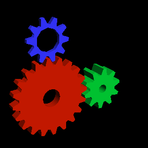

# Gears



The classic spinning-gears demo, drawn with Vulkan from Guile in an X11
window. It needs only Guile, a Vulkan 1.3 driver and libX11. On Wayland
desktops the window opens through XWayland.

## Running

From the repository root:

```sh
guile -L . examples/gears/gears.scm [--device N] [--novsync] [--frames N]
```

- `--device N`: use the Nth Vulkan device instead of the first suitable one.
- `--novsync`: present as fast as possible (mailbox or immediate mode)
  instead of in step with the display.
- `--frames N`: quit after N frames (handy for testing).

Keys: the arrow keys rotate the view, `z` and `Z` rotate it around the
viewing axis, and Esc quits. Every 5 seconds it prints the frame rate.

## What it shows

- **Windowing without a toolkit:** `examples/x11.scm` binds the dozen Xlib
  calls it needs. X's event structs are described with `define-vk-struct`,
  so they're read with `vk-ref` like Vulkan structs.
- **Surface and swapchain:** `(vulkan xlib)` creates the surface. The
  swapchain is rebuilt when the window is resized or reported out of date.
- **Vulkan 1.3 dynamic rendering** (`vk:cmd-begin-rendering`), so there are
  no render pass or framebuffer objects. Layout transitions use
  `vk:cmd-pipeline-barrier2`.
- **Push constants only:** each gear's matrices and color are pushed with
  `vk:cmd-push-constants` (128 bytes), so there are no descriptor sets.
- **Two frames in flight,** with a fence per frame and a "rendering done"
  semaphore per swapchain image.
- **A flipped viewport** (negative height), so Y points up as in OpenGL and
  the classic geometry and winding work unchanged.

The gear geometry is the classic `gear()` routine, rebuilt as triangles in
Scheme. The matrix math is in `examples/math.scm`.

## Shaders

`gears.vert` does per-vertex lighting, like the fixed-function OpenGL
lighting the original demo used; `gears.frag` passes the color through. The
compiled `.spv` files are in the repository. To rebuild them:

```sh
glslangValidator -V examples/gears/gears.vert -o examples/gears/gears.vert.spv
glslangValidator -V examples/gears/gears.frag -o examples/gears/gears.frag.spv
```
