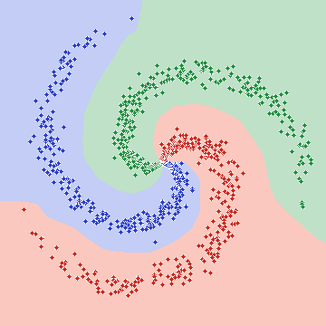

# Spirals



A small neural network trained on the GPU with `(vulkan compute)`. It learns
to tell three interleaved spirals apart, then draws what it learned: each
point of the plane is colored by the class the network predicts, and the
training points are drawn on top.

## Running

From the repository root:

```sh
guile -L . examples/spirals/spirals.scm [--device N] [--steps N] [--output FILE]
```

- `--device N`: train on the Nth Vulkan device (by default the most capable).
- `--steps N`: gradient-descent steps (default 3000).
- `--output FILE`: where to write the picture, as a PPM (default
  `spirals.ppm`).

It prints the loss and training accuracy as it goes:

```
step     1  loss 1.1574  accuracy 38.4%
step   500  loss 0.0460  accuracy 99.7%
...
step  3000  loss 0.0420  accuracy 98.9%
3000 steps in 6.41 s (468 steps/s)
```

The 3000 steps take about 4 to 7 seconds on a current GPU, and about 20
seconds on Mesa's software renderer.

## How it works

- **Data:** 300 noisy points per spiral (as in the CS231n course notes),
  generated in Scheme.
- **Network:** 2 inputs → 64 → 64 → 3 classes, with ReLU between the layers
  and softmax at the end, initialized with He initialization.
- **Training:** full-batch gradient descent on the cross-entropy loss, with
  a little L2 regularization. The forward pass, backpropagation and
  parameter updates are all `(vulkan compute)` operations:
  - `tensor-matmul` with `#:transpose-a?` / `#:transpose-b?` for the
    gradients;
  - `tensor-add` with a row for the biases;
  - `tensor-relu-backward` through the activations;
  - `tensor-sum-rows` for the bias gradients;
  - `tensor-softmax-rows` for the output.
- **Reading results back:** only the loss reports and the final picture are
  read from the GPU. Between them, each step's operations are queued and
  run in batches, and the buffers of each step's temporary tensors are
  reused by the next.
- **The picture:** the network is evaluated on a 360×360 grid, 129,600
  points in one batch, also on the GPU.

The whole example is about 150 lines of Scheme, with no dependencies beyond
guile-vulkan.
